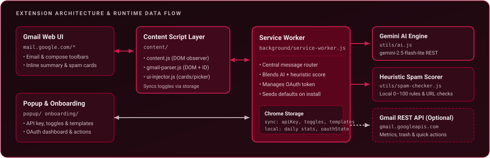
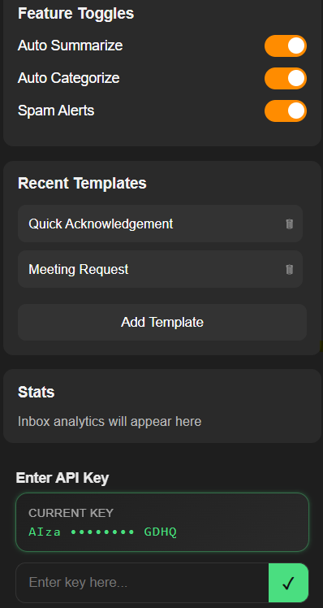
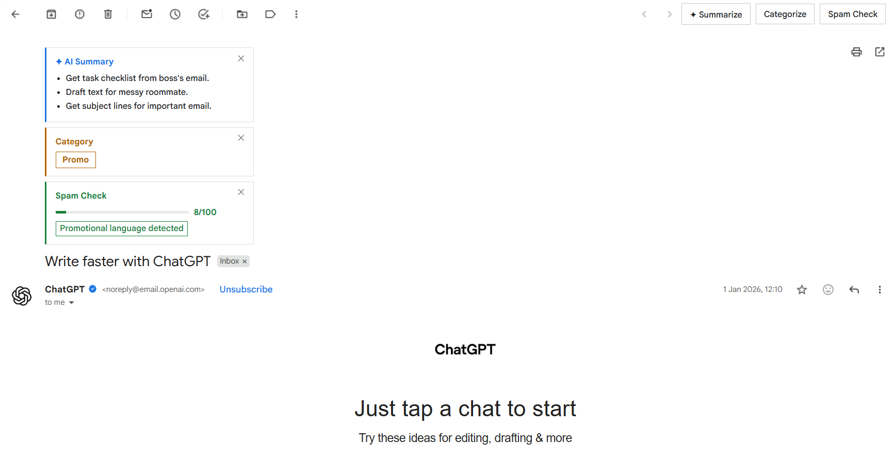
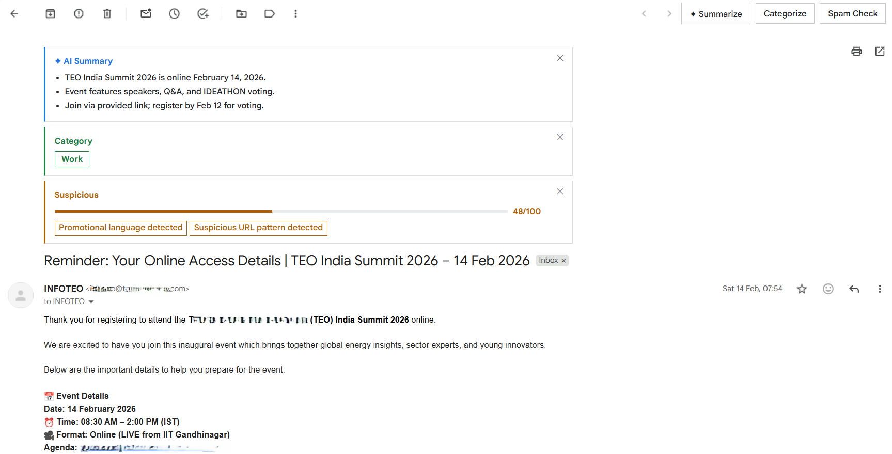
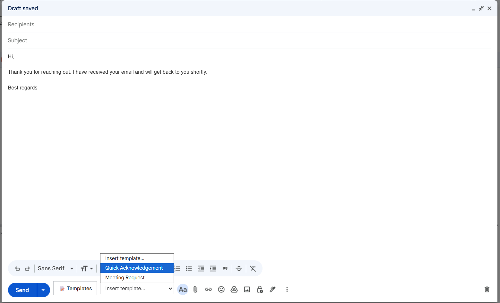

<p align="center">
  
</p>

**MailOut AI** (`v1.3`) is a client-side **Chrome Extension (Manifest V3)** that brings AI-powered email summarization, strict categorization, hybrid spam detection, and reusable reply templates directly inside Gmail — with zero backend servers and full local control over your API key.

<p align="left">
  <a href="manifest.json"></a>
  <a href="manifest.json"></a>
  <a href="utils/ai.js"></a>
  <a href="LICENSE"></a>
  <a href="CONTRIBUTING.md"></a>
</p>

<p align="left">
  <a href="#core-capabilities">Capabilities</a> •
  <a href="#architecture">Architecture</a> •
  <a href="#quick-start">Quick Start</a> •
  <a href="#optional-gmail-oauth-setup">OAuth Setup</a> •
  <a href="#permissions--privacy">Permissions &amp; Privacy</a> •
  <a href="#screenshots">Screenshots</a>
</p>


## Core Capabilities

| Icon | Capability | Details |
| :---: | :--- | :--- |
|  | **AI Email Summarization** | Adds a `✦ Summarize` button to Gmail's toolbar. Generates **3 concise bullet points** (&lt; 12 words each, temperature `0.3`, inputs truncated at 3,000 chars) via `gemini-2.5-flash-lite`. |
|  | **Strict Email Categorization** | Adds a `Categorize` button that classifies each thread into exactly one label: `Work`, `Personal`, `Promo`, `Urgent`, or `Spam`. |
|  | **Hybrid Spam Shield (0–100)** | Blends deterministic local heuristics ([`utils/spam-checker.js`](utils/spam-checker.js)) with LLM reasoning ([`spamAnalyzeEmail`](utils/ai.js)) into `safe`, `suspicious`, or `danger` verdicts (default threshold `60`). |
|  | **Compose Reply Templates** | Injects a `📝 Templates` picker directly into Gmail's compose toolbar. Add, reorder via drag-and-drop, and delete templates from the extension popup. |
|  | **Inbox Dashboard & Quick Actions** | Optional Gmail OAuth mode unlocks 7-day received/sent metrics, daily local counters, a daily inbox digest (*"Here's what you missed today"*), **Move to Trash** on danger cards, and 5 bulk cleanup actions. |

### How Hybrid Spam Scoring Works

The `Spam Check` action runs two checks in parallel inside [`background/service-worker.js`](background/service-worker.js) and merges their scores using `round(max(heuristic, ai, (heuristic + ai) / 2))`:

- **Local Heuristic Engine** ([`utils/spam-checker.js`](utils/spam-checker.js)): Evaluates known bulk/promo sender domains, missing or digit-heavy sender domains, high-risk scam phrases, promotional keyword density (capped at `+30`), ALL CAPS subjects, repeated exclamation marks, money/discount subject patterns, raw-IP or shortened URLs, high link counts (`> 5`), and short link-only bodies (`< 100` chars with URLs).
- **AI Security Verdict** ([`utils/ai.js`](utils/ai.js)): Evaluates sender, subject, and body context and returns structured JSON (`score`, `level`, `flags`, `reasoning`).


## Architecture

<p align="center">
  
</p>

| Layer | Files | Responsibility |
| :--- | :--- | :--- |
| **Manifest & Permissions** | [`manifest.json`](manifest.json) | Manifest V3 config, `mail.google.com` content script registration, `web_accessible_resources`, and OAuth2 scopes. |
| **Gmail Content Layer** | [`content/content.js`](content/content.js)<br>[`content/gmail-parser.js`](content/gmail-parser.js)<br>[`content/ui-injector.js`](content/ui-injector.js) | Watches Gmail SPA navigation via `MutationObserver`, extracts subject/sender/body and URL-hash message IDs, and injects toolbar buttons, compose template picker, and inline result cards (`#mailout-ai-root`). |
| **Background Service Worker** | [`background/service-worker.js`](background/service-worker.js) | Central ES-module message router (`chrome.runtime.onMessage`), orchestrates AI/heuristic calls, manages `chrome.identity` OAuth tokens and Gmail REST calls, resets daily counters, and seeds storage defaults. |
| **AI & Heuristic Engines** | [`utils/ai.js`](utils/ai.js)<br>[`utils/spam-checker.js`](utils/spam-checker.js) | `gemini-2.5-flash-lite:generateContent` prompt wrappers (`summarizeEmail`, `categorizeEmail`, `spamAnalyzeEmail`, `checkImportance`, `summarizeDigest`) and deterministic 0–100 spam scorer (`checkSpam`). |
| **Popup & Onboarding UI** | [`popup/popup.html`](popup/popup.html), [`popup/popup.js`](popup/popup.js)<br>[`onboarding/index.html`](onboarding/index.html), [`onboarding/onboarding.js`](onboarding/onboarding.js) | First-run API key verification, feature toggles (`autoSummarize`, `autoCategorize`, `spamAlerts`), template management, and OAuth-gated dashboard & quick actions. |

### Storage Layout

- **`chrome.storage.sync`**: `apiKey`, `autoSummarize`, `autoCategorize`, `spamAlerts`, `autoImportant`, `spamThreshold` (default `60`), `templates`.
- **`chrome.storage.local`**: Daily-reset usage counters (`emailsAnalyzed`, `spamDetected`, `emailsTrashed`, `importantLabeled`, `lastReset`), `oauthConnected`, `oauthEmail`, `onboardingGeminiOk`, `onboardingComplete`.


## Quick Start

### Requirements
- Google Chrome (latest recommended) or any Chromium-based browser supporting Manifest V3
- Internet connection (required for Gemini API and optional Gmail API calls)
- A free Gemini API key from [Google AI Studio](https://aistudio.google.com/app/apikey)

### 1. Get the Extension

Clone the repository directly (or download a packaged `.zip` from [Releases](https://github.com/Automate-Workflow/mail-out/releases)):

```bash
git clone https://github.com/Automate-Workflow/mail-out.git
```

### 2. Load Unpacked in Chrome

1. Open `chrome://extensions/` in your browser.
2. Turn on **Developer mode** (top-right toggle).
3. Click **Load unpacked** and select the `mail-out` folder.
4. The onboarding page ([`onboarding/index.html`](onboarding/index.html)) opens automatically on install.

### 3. Configure Gemini API Key

1. Create an API key in [Google AI Studio](https://aistudio.google.com/app/apikey).
2. Paste it into **Step 1** on the onboarding page (or later inside the extension popup), click **Save**, then click **Verify key works**.
3. Click **Skip for now** on Step 2 if you want to use Gmail features without OAuth.
4. Open [Gmail](https://mail.google.com/), open any email, and click **`✦ Summarize`**, **`Categorize`**, or **`Spam Check`** in the email toolbar.


## Optional Gmail OAuth Setup

Core summarization, categorization, spam scoring, and compose templates work **without OAuth**. To enable the **Inbox Dashboard**, **Move to Trash** button on spam cards, and popup quick actions (`Archive all newsletters`, `Summarize today's emails`, `Show only urgent`, `Auto‑unsubscribe suggestions`, `Auto‑delete old irrelevant`):

<details>
<summary>Step-by-step Google Cloud OAuth configuration</summary>

1. Create a project in [Google Cloud Console](https://console.cloud.google.com/) and enable the **Gmail API**.
2. Configure the **OAuth consent screen** (External, Testing mode, and add your Gmail address as a test user).
3. Create an **OAuth Client ID** with application type **Chrome Extension**, pasting the Extension ID shown at `chrome://extensions/`.
4. Open [`manifest.json`](manifest.json) and replace `"YOUR_OAUTH_CLIENT_ID_HERE"` under `oauth2.client_id` with your generated Client ID.
5. Reload the extension in `chrome://extensions/`, then click **Connect Gmail** in the popup or onboarding page.

</details>

> **Current Implementation Notes**
> - Automatic Gmail label application on `CATEGORIZE` / `CHECK_IMPORTANCE` and automatic on-open importance checks (`runImportanceCheck`) are currently disabled stubs while OAuth labeling is finalized.
> - Insert reply templates using the **`📝 Templates`** button inside Gmail's compose toolbar; clicking a template inside the popup (`INSERT_TEMPLATE`) is not yet forwarded to the active tab by the service worker.


## Permissions & Privacy

| Permission / Host | Why It Is Requested |
| :--- | :--- |
| `storage` | Persists your Gemini API key, feature toggles, templates, and local stats via `chrome.storage.sync` / `chrome.storage.local`. |
| `activeTab`, `scripting` | Supports active Gmail tab context and content interaction. |
| `identity` | Powers optional Google OAuth (`chrome.identity.getAuthToken`) for Gmail API access. |
| `https://mail.google.com/*` | Runs the Gmail DOM parser and UI injector exclusively on Gmail web pages. |
| `https://gmail.googleapis.com/*`, `https://www.googleapis.com/*` | Reads Gmail profile/labels/metadata and performs user-triggered archive/trash/label actions when OAuth is connected. |

- **No backend server:** All logic executes locally in your browser; API requests go directly from the extension service worker to Google's Gemini and Gmail APIs.
- **No email persistence:** Email bodies are processed in memory and are not stored on disk or sent to third-party servers.


## Project Structure

```text
mail-out/
├── manifest.json                 # Extension MV3 manifest, permissions & OAuth scopes
├── assets/                       # README banner, dividers, architecture SVG & feature icons
├── background/
│   └── service-worker.js         # Message router, hybrid spam aggregation, OAuth & quick actions
├── content/
│   ├── content.js                # Gmail SPA observer, action handlers & storage sync
│   ├── gmail-parser.js           # Email subject/sender/body & compose toolbar extraction
│   └── ui-injector.js            # Toolbar buttons, inline result cards & template picker
├── onboarding/
│   ├── index.html                # First-run setup wizard (Gemini key + optional OAuth)
│   ├── onboarding.css            # Onboarding styling
│   └── onboarding.js             # Key verification & OAuth connection logic
├── popup/
│   ├── popup.html                # Extension toolbar popup UI
│   ├── popup.css                 # Popup dark theme styling
│   └── popup.js                  # Toggles, template CRUD, API key input & dashboard controller
├── utils/
│   ├── ai.js                     # Gemini 2.5 Flash Lite API client & prompts
│   └── spam-checker.js           # Deterministic 0–100 spam heuristic engine
├── icons/                        # Extension icon (128x128)
├── images/                       # Documentation screenshots
├── CONTRIBUTING.md               # Contribution guidelines & AI constraints
├── CODE_OF_CONDUCT.md            # Community standards & enforcement contact
├── SECURITY.md                   # Security design & private vulnerability reporting
└── LICENSE                       # MIT License
```


## Screenshots

| Extension Popup | Promotional Email Analysis |
| :---: | :---: |
|  |  |

| Suspicious Email Warning | Compose Template Picker |
| :---: | :---: |
|  |  |


## Contributing & Community

- **Contributing:** Read [CONTRIBUTING.md](CONTRIBUTING.md) before opening a pull request.
- **Security:** Report vulnerabilities privately via [GitHub Security Advisories](https://github.com/Automate-Workflow/mail-out/security/advisories/new) or email `ayush_24a12res897@iitp.ac.in` — see [SECURITY.md](SECURITY.md).
- **Code of Conduct:** Participation is governed by [CODE_OF_CONDUCT.md](CODE_OF_CONDUCT.md).

## Maintainer

Maintained by **Ayush Raj** ([ayushcmd](https://github.com/ayushcmd)) under [Automate-Workflow](https://github.com/Automate-Workflow).

## License

MIT License — see [LICENSE](LICENSE).
